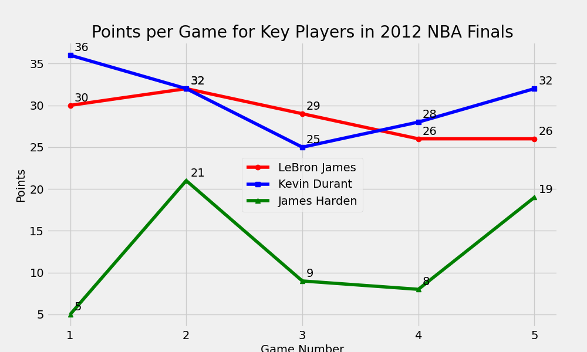
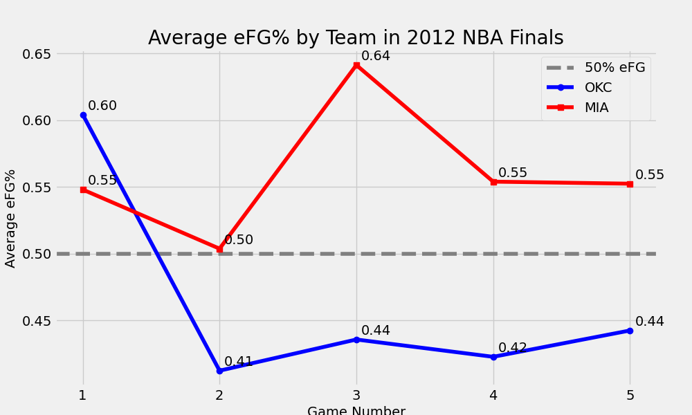
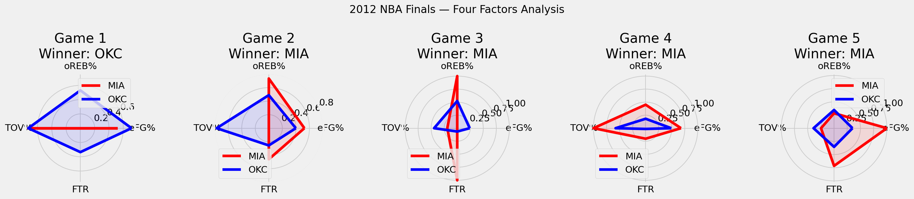
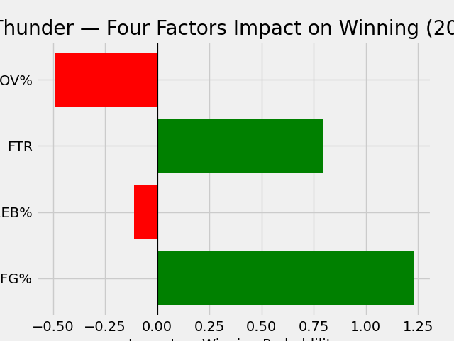
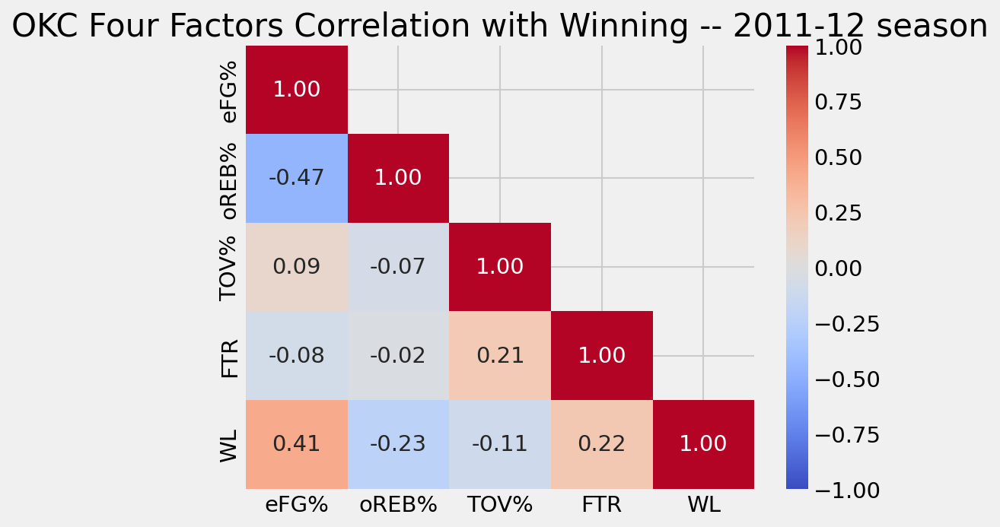

# 2012 NBA Finals: How the LeBron James and the Heat dominated

The 2012 NBA Finals pitted the OKC Thunder and Miami Heat against each other in one of the most anticipated finals matchups in modern history. The Heat, featuring their big 3 of LeBron James, Dwyane Wade and Chris Bosh, were looking for redemption after failing to capture the Larry O’Brien trophy the previous season. The upstart Thunder, with their young core of Kevin Durant, Russell Westbrook and James Harden, were viewed as the next great team. Having taken down 3 storied franchises and recent champions in the Mavericks, Lakers, and Spurs leading up to the series, the Thunder were considered favorites by the oddsmakers. The belief was that this was the beginning of a dynasty. What ensued was a thorough demolition at the hands of Miami led by LeBron James, securing his first championship.

That the Heat won isn't a surprise - they were favorites to win before the season started. The real question is why it was such a shellacking- a gentleman’s sweep and 4 straight losses. In this analysis, my goal is to answer the question. I’ll be utilizing tools like pandas, numpy, matplotlib, scikit-learn, nba_api and more to comb through the data and crack the mystery of this surprising outcome.

## Approach

1. Pull OKC's 2011-12 games and the Finals box scores from the NBA stats API.
2. Compute possessions and the Four Factors (effective field goal %, offensive rebound %, turnover %, free throw rate) for each team in each Finals game.
3. Compare the Finals against regular-season baselines, and look at how each factor relates to winning for OKC across the whole season.

## Charts

| Chart | What it shows |
| --- | --- |
|  | Points per game for LeBron James, Kevin Durant and James Harden across the Finals |
|  | Both teams' effective field goal % by game, against the regular-season average |
|  | Game-by-game Four Factors for both teams, normalized |
|  | Relative impact of each of the Four Factors |
|  | Correlation between OKC's Four Factors and winning, 2011-12 season |

## Tools

Python, pandas, NumPy, matplotlib, seaborn, scikit-learn, nba_api, Jupyter

## Data Sources

NBA stats API through the [`nba_api`](https://github.com/swar/nba_api) package: `LeagueGameFinder` for game lists and `BoxScoreTraditionalV3` for box scores.

## How to run

1. Install the dependencies: `pip install pandas numpy matplotlib seaborn scikit-learn nba_api jupyter`
2. Open `notebooks/2012_nba_finals_analysis.ipynb` in Jupyter.
3. Run all cells. The notebook pulls data from the NBA stats API, so you need an internet connection.

## Repo Structure

| Path | What |
| --- | --- |
| `notebooks/2012_nba_finals_analysis.ipynb` | The full analysis |
| `data/` | Chart images generated by the notebook |
